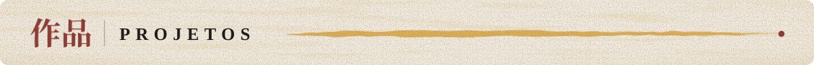
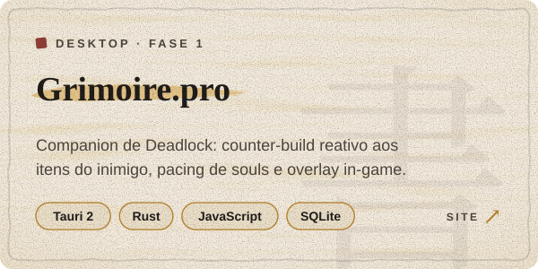
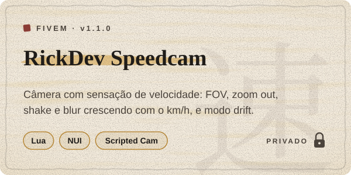
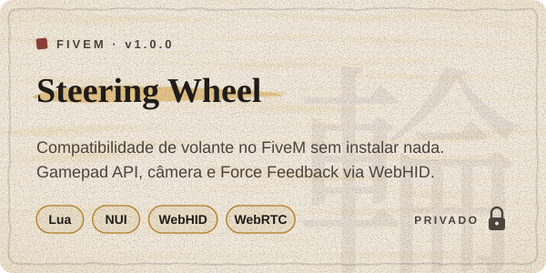
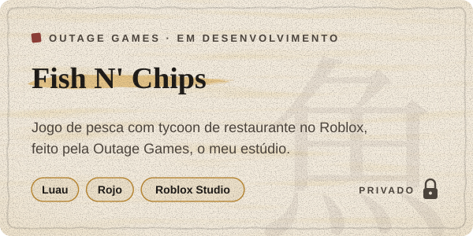
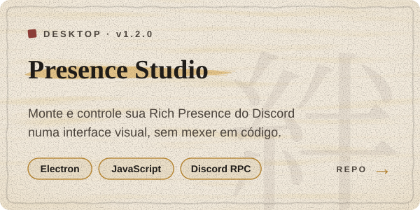
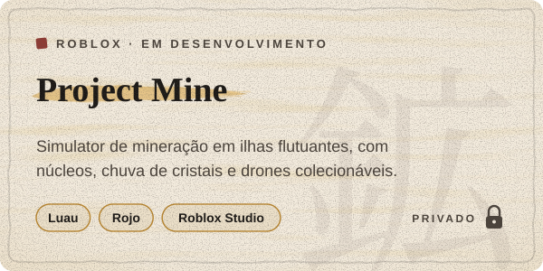
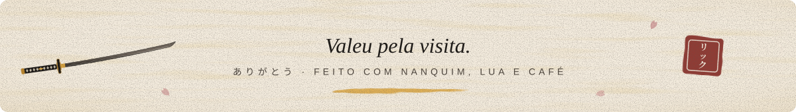

<!--
  README do perfil — estilo sumi-e (papel, nanquim, ouro e carimbo).
  SVGs de ./assets:  node tools/build-assets.mjs
  Prévia local:      node tools/preview.mjs  (depois abra preview.html)
-->

  
   
  

Fala! Aqui é o **RickDev**. Programo principalmente para **FiveM / QBCore**: scripts, sistemas e NUI, atualmente para o servidor **Sertão Roleplay**. Fora do GTA, faço apps desktop (geralmente para resolver problemas próprios), dois jogos no Roblox e estou começando a aprender um pouco de Blender.

- 🗡️ **FiveM / QBCore:** sistema único de câmera para veículos, volante com Force Feedback, HUDs e muito mais
- 🖥️ **Desktop:** [Grimoire.pro](https://companiongrimoire.pro), companion de Deadlock (Tauri + Rust), e [Presence Studio](https://github.com/Eu-RickDev/RickDev-presence-studio), Rich Presence do Discord sem código (Electron)
- 🎣 **Roblox:** Fish N' Chips pela **Outage Games**, o meu estúdio, e um simulator de mineração (Luau + Rojo)
- 🎬 **Extra:** Blender, edição de vídeo e a identidade visual dos próprios projetos

  

  
  
  

  
  
  
  
  
  

- 🏎️ Force Feedback do volante direto pelo navegador, sem o jogador instalar nada
- 🎣 Fish N' Chips: mecânicas prontas, agora indo para arte e som
- 📖 Grimoire.pro: leitura da partida ao vivo e análise pós-partida

<!--
  Status ao vivo do Discord (Lanyard). Para ligar:
  1) entre no servidor do Lanyard: https://discord.gg/lanyard
  2) troque SEU_ID_DISCORD pelo seu ID (Discord > Configurações > Avançado > Modo desenvolvedor > clique direito no perfil > Copiar ID)
  3) apague estas linhas de comentário

  

-->

<!--
  Quando tiver mais repos públicos, descomente os stats (já nas cores da marca):

  
  

-->

  
  
   
  
  

